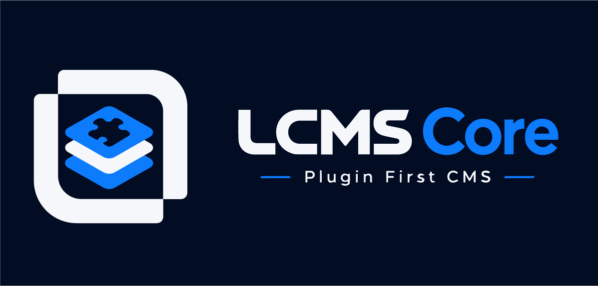
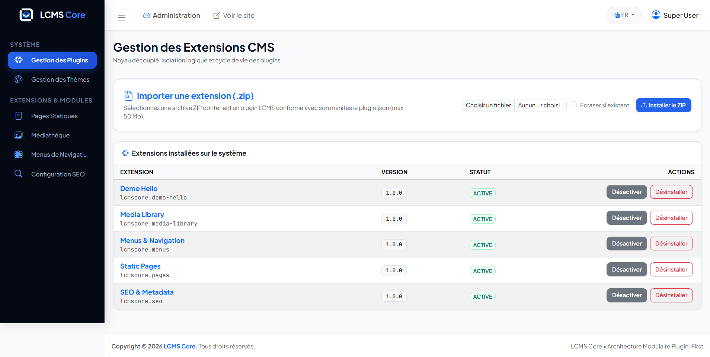
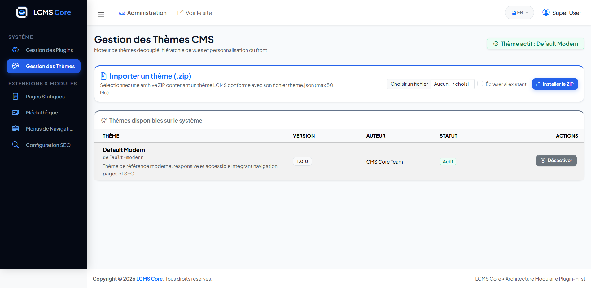
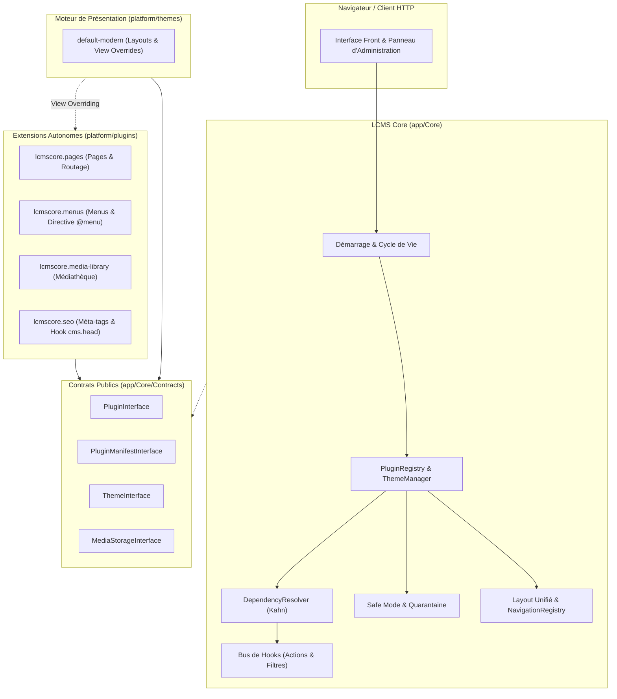

# LCMS Core — Laravel Plugin-First CMS

<p align="center">
  
</p>

<p align="center">
  <strong>Système de gestion de contenu modulaire, extensible et résilient, fondé sur un noyau minimaliste Laravel et une architecture découplée pilotée par des contrats publics.</strong>
</p>

<p align="center">
  <a href="https://packagist.org/packages/elouafidev/lcms-core"></a>
  <a href="https://php.net"></a>
  <a href="https://laravel.com"></a>
  <a href="https://github.com/elouafidev/lcms-core"></a>
  <a href="https://github.com/elouafidev/lcms-core"></a>
  <a href="https://github.com/elouafidev/lcms-core"></a>
  <a href="LICENSE"></a>
</p>

---

## 📖 À Propos de LCMS Core

Contrairement aux CMS traditionnels qui intègrent nativement des modèles de données rigides (pages, articles, médiathèque, formulaires ou commerce électronique en dur dans le noyau), **LCMS Core** implémente une séparation architecturale radicale :

1. **Noyau Minimal (*Lean Core*) :** Le noyau (`app/Core/`) ne contient **aucune logique métier**. Il assure exclusivement les services d'infrastructure : authentification racine, découverte d'extensions, validation de manifestes, résolution topologique des dépendances, bus d'interception (Hooks), tolérance aux crashs et layout d'administration unifié.
2. **Contrats Publics Stricts (`app/Core/Contracts/`) :** Les extensions ne communiquent jamais directement entre leurs implémentations privées. Tout échange s'opère via des contrats immuables et le conteneur IoC de Laravel.
3. **Écosystème de Plugins Autonomes (`platform/plugins/`) :** Chaque fonctionnalité métier (pages statiques, arborescences de navigation, médiathèque, méta-tags SEO) est portée par une extension indépendante possédant ses propres routes, contrôleurs, vues Blade, permissions et migrations isolées.
4. **Moteur de Thèmes Découplé (`platform/themes/`) :** Système de présentation autonome capable de surcharger dynamiquement (*View Overriding*) les templates des plugins sans toucher à leur code source.

---

## 🚀 Fonctionnalités Clés

- 🧩 **Architecture 100% Modulaire :** Activez, désactivez ou supprimez des fonctionnalités sans altérer le noyau.
- 📐 **Résolution Topologique des Dépendances (Algorithme de Kahn) :** Ordonnancement déterministe au démarrage, détection préventive des cycles (`CircularDependencyException`) et gardes de dépendances inverses pour interdire les désactivations en cascade non confirmées.
- 🛡️ **Sécurité Renforcée & Double Authentification (2FA TOTP) :** Protection des comptes avec TOTP native (Google/Microsoft Authenticator), QR-code SVG vectoriel autonome sans API tierce, codes de récupération chiffrés et commandes d'urgence CLI.
- 👥 **Gestion des Rôles & Permissions (RBAC) :** Matrice d'autorisations fine, protection des rôles système (`super_admin`), assignations multiples et administration centralisée des utilisateurs avec révocation de sessions distantes.
- ⚙️ **Paramètres & Configuration Runtime :** Moteur `SettingManager` avec stockage typé/chiffré en base (`cms_settings`), surcharges dynamiques, testeur SMTP interactif en temps réel et mode maintenance HTTP 503 avec contournement administrateur.
- 📦 **Moteur de Mise à Jour Core par Archive ZIP :** Déploiement simplifié des mises à jour du noyau sans accès SSH avec validation anti-Zip-Slip, sauvegarde préalable automatique (`BackupService`), tolérance aux pannes et rollback instantané.
- 🎨 **Moteur de Thèmes & Personnalisation d'Apparence :** Thème de référence `default-modern`, publication directe des assets depuis l'admin (`cms:theme:publish-assets --all`), inspecteur modal de thèmes et éditeur en direct pour injecter balises `<head>`, CSS et scripts JS publics.
- 🧯 **Résilience & Tolérance aux Pannes :**
  - **Mise en Quarantaine Automatique :** Si une extension déclenche une exception fatale au boot, elle est isolée en base (`cms_plugin_errors`) sans bloquer le reste de l'application.
  - **Mode de Secours (*Emergency Safe Mode*) :** Bypass immédiat de toutes les extensions tierces via commande CLI (`cms:recovery:safe-mode --on`) ou désactivation d'urgence du 2FA (`cms:recovery:disable-2fa`) pour restaurer l'accès administrateur en cas d'incident critique.
- 📦 **Installation Sécurisée d'Extensions ZIP :** Import direct depuis le tableau de bord avec protection stricte contre le **Zip Slip**, rejet des extensions exécutables interdites (`.exe`, `.sh`, `.phar`, etc.), extraction sandboxée et validation de schéma JSON.
- 🪝 **Bus de Hooks Extensible :** Système d'actions et de filtres priorisés (`Hook::action()`, `Hook::filter()`) pour personnaliser le comportement du CMS sans modifier le code source.
- 🖥️ **Panneau d'Administration Unifié & Ergonomique :** Interface moderne basée sur AdminLTE 4 et Tailwind CSS avec arborescences treeview pour les paramètres et l'apparence, barre latérale sombre (`#050914`), header épuré et badge `SuperAdmin`.
- 🌐 **Internationalisation & Multilingue (i18n) :** Prise en charge native du français (`fr`) et de l'anglais (`en`), architecture de localisation JSON centralisée (`lang/fr.json`).
- 💾 **Propriété Stricte des Données :** Migrations isolées par extension avec journalisation dédiée (`cms_plugin_migrations`). La désactivation conserve les tables ; la désinstallation propose une purge optionnelle et explicite.

---

## 📸 Aperçu du Panneau d'Administration

LCMS Core offre une interface d'administration épurée, responsive et cohérente, facilitant la supervision globale des extensions et des thèmes :

### 🧩 Gestion et Cycle de Vie des Extensions (Plugins)
*Supervision en temps réel des extensions, activation/désactivation sécurisée, résolution des dépendances et téléversement d'archives ZIP.*

<p align="center">
  
</p>

### 🎨 Gestion et Activation des Thèmes
*Activation instantanée du thème de rendu public, prévisualisation, gestion des métadonnées et surcharge automatique des vues Blade.*

<p align="center">
  
</p>

---

## 🏛️ Architecture du Système



---

## 📦 Extensions & Thèmes Fournis

| Identifiant | Rôle & Fonctionnalités | Contrats & Hooks |
|---|---|---|
| [`lcmscore.pages`](platform/plugins/lcmscore.pages) | Gestion des pages statiques avec slugs personnalisés, publication/brouillon et routes dynamiques `/page/{slug}`. | `PluginInterface` |
| [`lcmscore.menus`](platform/plugins/lcmscore.menus) | Gestion hiérarchique des éléments de navigation, directive Blade `@menu('main-nav')` et filtre `cms.menu`. | `PluginInterface`, `HookSubscriberInterface` |
| [`lcmscore.media-library`](platform/plugins/lcmscore.media-library) | Stockage et organisation des fichiers médias avec upload sécurisé et gestion des métadonnées. | `MediaStorageInterface` |
| [`lcmscore.seo`](platform/plugins/lcmscore.seo) | Optimisation pour moteurs de recherche, liens canoniques et métadonnées OpenGraph injectées via le filtre `cms.head`. | `HookSubscriberInterface` |
| [`default-modern`](platform/themes/default-modern) | Thème responsive moderne avec typographie soignée, intégration fluide des menus, des pages et surcharge de templates de plugins. | `ThemeInterface` |

---

## 🛠️ Installation et Démarrage Rapide

### Prérequis Système
- **PHP** : `^8.2` ou `^8.3` avec extensions `mbstring`, `xml`, `sqlite3`, `curl`, `zip`.
- **Composer** : `2.x`.
- **Base de données** : SQLite (par défaut pour le développement) ou PostgreSQL / MySQL.

### Option 1 (Recommandée) : Créer un projet via Composer (Packagist)

Vous pouvez initialiser une nouvelle instance de LCMS Core en une seule commande grâce à Composer et Packagist :

```bash
composer create-project elouafidev/lcms-core mon-projet-lcms
cd mon-projet-lcms
php artisan serve
```

> [!TIP]
> **Ce que Composer exécute automatiquement pour vous :**
> - Téléchargement du template et installation des dépendances PHP.
> - Création du fichier `.env` et génération de la clé de chiffrement `APP_KEY`.
> - Création du fichier de base de données SQLite `database/database.sqlite`.
> - Exécution automatique des migrations du noyau et des extensions initiales.
> - Seeding automatique du compte Super Administrateur racine.
> 
> Votre CMS est opérationnel instantanément sans configuration manuelle !

---

### Option 2 : Cloner depuis GitHub

#### Initialisation Automatique
```bash
git clone https://github.com/elouafidev/lcms-core.git
cd lcms-core

# Routine complète (installation, .env, clé, migration, seed, build)
composer run setup

# Lancer le serveur local
php artisan serve
```

#### Initialisation Manuelle
```bash
git clone https://github.com/elouafidev/lcms-core.git
cd lcms-core

# Copier la configuration
cp .env.example .env

# Installer les dépendances backend
composer install

# Générer la clé de chiffrement
php artisan key:generate

# Exécuter les migrations de base de données
php artisan migrate

# Peupler la base de données avec le compte Super Administrateur
php artisan db:seed

# Installer et compiler les dépendances front-end (optionnel)
npm install && npm run build

# Démarrer le serveur local
php artisan serve
```

### 4. Démarrer le Serveur Local
```bash
php artisan serve
```
- **Site public :** [http://localhost:8000](http://localhost:8000)
- **Panneau d'administration :** [http://localhost:8000/admin](http://localhost:8000/admin)

### 🔐 Identifiants par Défaut (Super Administrateur)

Le seeder du projet ([`database/seeders/UserSeeder.php`](database/seeders/UserSeeder.php)) préconfigure un compte super administrateur racine avec les identifiants d'accès suivants :

| Paramètre | Valeur par défaut |
|---|---|
| **URL de connexion** | [`http://localhost:8000/login`](http://localhost:8000/login) ou [`http://localhost:8000/admin`](http://localhost:8000/admin) |
| **Email** | `admin@lcms.local` |
| **Mot de passe** | `Password123!` |
| **Rôle / Droits** | `SuperAdmin` (accès complet aux modules d'administration, thèmes et extensions) |

> [!TIP]
> Si la base de données a été réinitialisée ou migrée sans seed, vous pouvez générer ou réinitialiser ce compte super administrateur à tout moment avec la commande :
> ```bash
> php artisan db:seed --class=UserSeeder
> ```

---

### 🔄 Procédure de Mise à Niveau (v1.0.0 ➔ v1.1.0)

Si vous mettez à jour une installation existante vers la version 1.1.0 :

```bash
# 1. Récupérer les dernières sources
git pull origin main

# 2. Mettre à jour les dépendances Composer (pragmarx/google2fa, bacon/bacon-qr-code)
composer install --no-dev --optimize-autoloader

# 3. Exécuter les nouvelles migrations du noyau (sécurité, RBAC, settings, audit, mises à jour)
php artisan migrate --force

# 4. Initialiser la matrice des rôles et autorisations par défaut
php artisan db:seed --class=RoleSeeder --force

# 5. Publier les assets des thèmes
php artisan cms:theme:publish-assets --all

# 6. Rafraîchir les caches applicatifs
php artisan config:cache
php artisan route:cache
php artisan view:cache
```

---

## 💻 Référence des Commandes Artisan

LCMS Core fournit un ensemble complet de commandes CLI pour piloter les extensions, les thèmes et la résilience :

### Gestion des Plugins (`cms:plugin:*`)
```bash
# Lister toutes les extensions et leur état
php artisan cms:plugin:list

# Activer et monter une extension
php artisan cms:plugin:enable lcmscore.pages

# Désactiver une extension (sans suppression de données)
php artisan cms:plugin:disable lcmscore.pages

# Publier les assets publics d'une extension vers public/vendor/plugins/
php artisan cms:plugin:publish-assets lcmscore.pages

# Exécuter les seeders d'une extension spécifique
php artisan cms:plugin:seed lcmscore.demo-hello

# Exécuter les seeders de toutes les extensions actives
php artisan cms:plugin:seed --all
```

### Gestion des Thèmes (`cms:theme:*`)
```bash
# Lister les thèmes disponibles et identifier le thème actif
php artisan cms:theme:list

# Activer un thème pour le rendu public
php artisan cms:theme:activate default-modern

# Publier les assets d'un thème spécifique vers public/vendor/themes/
php artisan cms:theme:publish-assets default-modern

# Publier / forcer la copie des assets de tous les thèmes installés
php artisan cms:theme:publish-assets --all
```

### Sécurité & Authentification à Deux Facteurs (`cms:security:*` / `cms:recovery:*`)
```bash
# Activer le 2FA TOTP pour un utilisateur administrateur via CLI
php artisan cms:security:enable-2fa admin@lcms.local

# Désactiver d'urgence le 2FA d'un compte bloqué
php artisan cms:recovery:disable-2fa admin@lcms.local
```

### Mode de Récupération d'Urgence (`cms:recovery:*`)
```bash
# Activer le Safe Mode (désactive temporairement toutes les extensions tierces)
php artisan cms:recovery:safe-mode --on

# Désactiver le Safe Mode et restaurer le démarrage normal
php artisan cms:recovery:safe-mode --off
```

---

## 🧩 Anatomie d'un Plugin LCMS

Chaque plugin est logé dans son propre sous-dossier au sein de `platform/plugins/{vendor}.{nom}/` et contient obligatoirement un manifeste immuable `plugin.json` :

```json
{
  "id": "lcmscore.mon-plugin",
  "name": "Mon Extension Métier",
  "version": "1.0.0",
  "description": "Exemple d'extension autonome pour LCMS Core",
  "author": {
    "name": "LCMS Core Development Team",
    "email": "contact@lcmscore.test",
    "homepage": "https://lcmscore.test"
  },
  "compatibility": {
    "php": "^8.2",
    "lcms": "^1.0"
  },
  "autoload": {
    "psr-4": {
      "Plugins\\MonPlugin\\": "src/"
    }
  },
  "providers": [
    "Plugins\\MonPlugin\\Providers\\MonPluginServiceProvider"
  ],
  "dependencies": {
    "lcmscore.media-library": "^1.0"
  },
  "conflicts": [],
  "permissions": [
    {
      "key": "mon_plugin.manage",
      "label": "Gérer les fonctionnalités de Mon Plugin"
    }
  ],
  "routes": {
    "web": "routes/web.php",
    "api": "routes/api.php"
  }
}
```

### Structure recommandée d'une extension :
```text
platform/plugins/lcmscore.mon-plugin/
├── plugin.json                 # Manifeste validé obligatoirement
├── database/
│   └── migrations/             # Migrations isolées du plugin
├── resources/
│   └── views/                  # Vues Blade (surchargeables par le thème)
├── routes/
│   └── web.php                 # Routes montées uniquement à l'état ACTIVE
└── src/
    ├── Http/Controllers/       # Contrôleurs isolés
    ├── Models/                 # Modèles Eloquent du plugin
    └── Providers/              # ServiceProviders enregistrés au boot
```

---

## 🔒 Sécurité et Robustesse

Le projet applique les principes de défense en profondeur documentés dans nos modèles de menaces :

- **Prévention du Zip Slip & Attaques de Décompression :** `PluginZipInstaller` contrôle chaque segment de chemin (`..`, séparateurs de lecteur, barres obliques absolues) et refuse catégoriquement l'extraction hors du bac à sable temporaire.
- **Filtrage des Fichiers Exécutables :** Interdiction stricte de toute extension potentiellement dangereuse (`.exe`, `.sh`, `.bat`, `.cmd`, `.phar`, `.phtml`, etc.) dans les archives téléversées.
- **Protection Anti-Traversal sur les Manifestes :** Les chemins de routes et d'autoloading déclarés dans `plugin.json` sont inspectés par `ManifestValidator` pour bloquer les tentatives de saut de répertoire.
- **Isolation d'Exécution :** L'enregistrement des `ServiceProvider` des plugins est encapsulé dans une frontière de capture de fautes ; tout crash est capturé et le composant incriminé est consigné en quarantaine.
- **Authentification & Contrôles CSRF :** Toutes les actions d'activation, de désactivation, de téléversement et de désinstallation d'extensions sont protégées par une authentification administrateur et un jeton CSRF.

---

## 🧪 Assurance Qualité & Tests

Le projet est couvert par une suite rigoureuse de **291 tests automatisés** (1 811 assertions) sans aucun contournement :

```bash
# Exécuter l'intégralité de la suite de tests
composer test

# Lancer l'analyse statique au niveau maximal (Niveau 8)
composer run analyse

# Vérifier la conformité du style de code
composer run lint

# Formater automatiquement le code selon les standards Laravel
composer run format
```

---

## 📚 Documentation Technique

La documentation technique interactive officielle au format HTML est disponible dans le dossier [`docs/`](docs/) :

- 🌐 **[Portail de Documentation Technique Complète (docs/index.html)](docs/index.html)** :
  - **🚀 Installation & Démarrage Rapide :** Déploiement Packagist via `composer create-project`, configuration `.env`, gestion du compte Super Administrateur.
  - **🏛️ Architecture Globale :** Philosophie Lean Core, Contrats Publics Stricts, ordonnancement topologique (Kahn), Bus de Hooks et Mode de Secours.
  - **🧩 Guide de Création de Plugins :** Anatomie, manifeste `plugin.json`, migrations isolées, seeders automatiques et publication d'assets.
  - **🎨 Moteur de Thèmes & Personnalisation :** Système de présentation autonome, surcharge hiérarchique des vues Blade (*View Overriding*) et injection de CSS/JS/`<head>`.
  - **⚙️ Paramètres, Sécurité 2FA & Maintenance :** Double authentification TOTP sans API tierce, passerelle SMTP avec tests en direct, diagnostics serveur et mode maintenance HTTP 503.
  - **👥 Contrôle d'Accès RBAC & Utilisateurs :** Matrice de permissions catégorisée, protection des rôles système et gestion avancée des sessions distantes.
  - **📦 Mises à Jour Core par Archive ZIP :** Moteur de déploiement sécurisé sans SSH, backups automatiques avec rétention et rollback instantané.
  - **💻 Référence Complète des Commandes Artisan :** Tableau exhaustif des commandes CLI `cms:*`.

---

## 📄 Licence

Ce projet est distribué sous licence open-source **MIT**. Consultez le fichier [LICENSE](LICENSE) pour plus d'informations.
