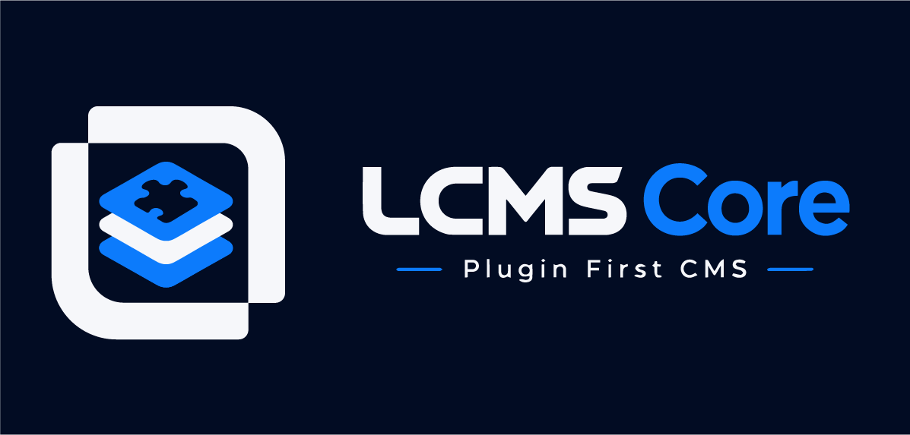
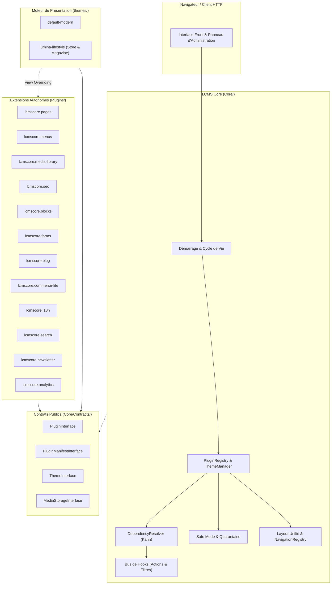

# LCMS Core — Laravel Plugin-First CMS

<p align="center">
  
</p>

<p align="center">
  <strong>Système de gestion de contenu modulaire, extensible et résilient, fondé sur un noyau minimaliste Laravel et une architecture découplée pilotée par des contrats publics.</strong>
</p>

<p align="center">
  <a href="https://packagist.org/packages/elouafidev/lcms-core"></a>
  <a href="https://github.com/elouafidev/lcms-core/releases"></a>
  <a href="https://php.net"></a>
  <a href="https://laravel.com"></a>
  <a href="https://github.com/elouafidev/lcms-core"></a>
  <a href="https://github.com/elouafidev/lcms-core"></a>
  <a href="https://github.com/elouafidev/lcms-core"></a>
  <a href="LICENSE"></a>
</p>

---

## 📖 À Propos de LCMS Core v2.0.0

Contrairement aux CMS monolithiques traditionnels qui intègrent nativement des modèles de données rigides en dur dans le noyau (pages, blog, boutique, formulaires ou médias imposés), **LCMS Core** met en œuvre une séparation architecturale radicale :

1. **Noyau Minimal (*Lean Core* à la racine `/Core`) :** Le noyau unifié ne contient **aucune logique métier**. Il assure exclusivement les services d'infrastructure : démarrage, authentification racine, découverte d'extensions, validation stricte de manifestes, résolution topologique des dépendances, bus d'interception (Hooks), résilience (Safe Mode / Quarantaine) et layout d'administration unifié AdminLTE 4.
2. **Contrats Publics Stricts (`Core/Contracts/`) :** Les extensions ne communiquent jamais directement entre leurs implémentations privées. Tout échange s'opère via des contrats immuables et le conteneur IoC de Laravel.
3. **Écosystème de Plugins Autonomes (`/Plugins`) :** Chaque fonctionnalité métier (pages statiques, arborescences de navigation, médiathèque, méta-tags SEO, blog, formulaires, boutique e-commerce, multilinguisme, recherche, etc.) est portée par une extension indépendante possédant ses propres routes, contrôleurs, vues Blade, permissions et migrations isolées.
4. **Moteur de Thèmes Découplé (`/themes`) :** Système de présentation autonome capable de surcharger dynamiquement (*View Overriding*) les templates des plugins sans toucher à leur code source, complété par des thèmes d'excellence (`default-modern`, `lumina-lifestyle`).

---

## 🚀 Fonctionnalités Clés

- 🧩 **Architecture 100% Modulaire & Découplée :** Activez, désactivez ou supprimez des fonctionnalités métier sans jamais toucher au noyau.
- 📐 **Résolution Topologique des Dépendances (Algorithme de Kahn) :** Ordonnancement déterministe au démarrage, détection préventive des cycles (`CircularDependencyException`) et gardes de dépendances inverses pour interdire les désactivations en cascade non confirmées.
- 🛡️ **Sécurité Renforcée & Double Authentification (2FA TOTP) :** Protection des comptes avec TOTP native (Google/Microsoft Authenticator), QR-code SVG vectoriel autonome sans API tierce, codes de récupération chiffrés et commandes d'urgence CLI.
- 👥 **Gestion des Rôles & Permissions (RBAC) :** Matrice d'autorisations fine, protection des rôles système (`super_admin`), assignations multiples et administration centralisée des utilisateurs avec révocation de sessions distantes.
- ⚙️ **Paramètres & Configuration Runtime :** Moteur `SettingManager` avec stockage typé/chiffré en base (`cms_settings`), surcharges dynamiques, testeur SMTP interactif en temps réel et mode maintenance HTTP 503 avec contournement administrateur.
- 📦 **Moteur de Mise à Jour Core par Archive ZIP :** Déploiement simplifié des mises à jour du noyau sans accès SSH avec validation anti-Zip-Slip, sauvegarde préalable automatique (`BackupService`), tolérance aux pannes et rollback instantané.
- 🎨 **Moteur de Thèmes & Personnalisation d'Apparence :**
  - **`default-modern` :** Thème épuré et minimaliste de référence.
  - **`lumina-lifestyle` :** Thème vitrine haut de gamme combinant un Journal / Magazine Slow-Living et une Boutique artisanale éco-responsable (palette lin & terracotta, 100% responsive, surcharges complètes de vues).
  - Publication directe des assets (`php artisan cms:theme:publish-assets --all`).
- 🧯 **Résilience & Tolérance aux Pannes :**
  - **Mise en Quarantaine Automatique :** Si une extension déclenche une exception fatale au boot, elle est isolée en base (`cms_plugin_errors`) sans bloquer le reste de l'application.
  - **Mode de Secours (*Emergency Safe Mode*) :** Bypass immédiat de toutes les extensions tierces via commande CLI (`php artisan cms:recovery:safe-mode --on`) ou désactivation d'urgence du 2FA (`php artisan cms:recovery:disable-2fa`) pour restaurer l'accès administrateur en cas d'incident critique.
- 📦 **Installation Sécurisée d'Extensions ZIP :** Import direct depuis le tableau de bord avec protection stricte contre le **Zip Slip**, rejet des extensions exécutables interdites (`.exe`, `.sh`, `.phar`, etc.), extraction sandboxée et validation de schéma JSON.
- 🪝 **Bus de Hooks Extensible :** Système d'actions et de filtres priorisés (`Hook::action()`, `Hook::filter()`) pour personnaliser le comportement du CMS sans modifier le code source.
- 🖥️ **Panneau d'Administration Unifié & Ergonomique :** Interface moderne basée sur AdminLTE 4 et Bootstrap 5.3 avec arborescences treeview pour les paramètres et l'apparence, barre latérale sombre (`#050914`), header épuré et badge `SuperAdmin`.
- 🌐 **Internationalisation & Multilingue (i18n) :** Prise en charge native multilingue via le plugin `lcmscore.i18n` avec sélecteur `@langSwitcher`, détection automatique et hreflang SEO.
- 💾 **Propriété Stricte des Données :** Migrations isolées par extension avec journalisation dédiée (`cms_plugin_migrations`). La désactivation conserve les tables ; la désinstallation propose une purge optionnelle et explicite.
- 🧪 **Jeu de Démonstration Clé en Main :** Commande console `php artisan lcms:seed-demo` peuplant en quelques secondes un magazine complet et une boutique artisanale opérationnelle.

---

## 🏛️ Architecture du Système



---

## 📦 Écosystème des Extensions Officielles

| Identifiant | Rôle & Fonctionnalités | Directives & Intégrations |
|---|---|---|
| [`lcmscore.pages`](Plugins/lcmscore.pages) | Pages statiques avec slugs personnalisés, publication/brouillon et routes dynamiques `/page/{slug}`. | `PluginInterface` |
| [`lcmscore.menus`](Plugins/lcmscore.menus) | Gestion hiérarchique de menus, sous-menus déroulants et rendu fluide. | `@menu('slug')`, filtre `cms.menu` |
| [`lcmscore.media-library`](Plugins/lcmscore.media-library) | Médiathèque centralisée, upload sécurisé et métadonnées d'images. | `MediaStorageInterface` |
| [`lcmscore.seo`](Plugins/lcmscore.seo) | Balises méta, OpenGraph, Twitter Cards et liens canoniques. | Filtre `cms.head` |
| [`lcmscore.blocks`](Plugins/lcmscore.blocks) | Blocs de contenu modulaires éditables (Hero, Valeurs, Témoignages, HTML libre). | `@renderBlock('slug')` |
| [`lcmscore.forms`](Plugins/lcmscore.forms) | Formulaires interactifs personnalisables avec champs dynamiques, protection honeypot et notification email. | `@renderForm('slug')` |
| [`lcmscore.blog`](Plugins/lcmscore.blog) | Moteur de blog/magazine complet avec catégories, étiquettes, temps de lecture estimé et flux RSS 2.0 (`/rss.xml`). | Routes `/blog`, `/rss.xml` |
| [`lcmscore.commerce-lite`](Plugins/lcmscore.commerce-lite) | Boutique artisanale légère, calculs monétaires stricts en centimes, panier d'achat en session et suivi des commandes. | `@cartButton`, `@price(cents)` |
| [`lcmscore.i18n`](Plugins/lcmscore.i18n) | Multilinguisme avancé, dictionnaire de langues, détection automatique et sélecteur interactif. | `@langSwitcher`, hreflang |
| [`lcmscore.search`](Plugins/lcmscore.search) | Moteur de recherche unifié indexant pages, articles et produits avec surbrillance des termes. | `@searchBar`, route `/search` |
| [`lcmscore.newsletter`](Plugins/lcmscore.newsletter) | Inscription newsletter avec double opt-in RGPD, protection anti-spam et export CSV. | `@newsletterForm` |
| [`lcmscore.redirects`](Plugins/lcmscore.redirects) | Gestionnaire de redirections HTTP 301/302 et journalisation en direct des erreurs 404. | `RedirectMiddleware` |
| [`lcmscore.analytics`](Plugins/lcmscore.analytics) | Statistiques de fréquentation RGPD sans cookies traceurs avec tableau de bord graphique. | Dashboard `/admin/analytics` |
| [`lcmscore.api-headless`](Plugins/lcmscore.api-headless) | API REST v1 découplée pour consommation externe (Next.js, Nuxt, Astro, Mobile) avec jetons d'accès Bearer. | Routes `/api/v1/*` |

---

## 🎨 Thèmes Inclus

| Thème | Description & Caractéristiques |
|---|---|
| [`default-modern`](themes/default-modern) | Thème minimaliste clair, responsive et accessible, parfait pour les sites institutionnels simples. |
| [`lumina-lifestyle`](themes/lumina-lifestyle) | Thème hybride d'exception combinant un Journal Slow-Living et une Boutique artisanale avec design system moderne (Playfair Display & Plus Jakarta Sans, terracotta & lin), surcharges de vues et intégration complète des plugins. |

---

## 🛠️ Installation et Démarrage Rapide

### Prérequis Système
- **PHP** : `^8.2` ou `^8.3` avec extensions `mbstring`, `xml`, `sqlite3`, `curl`, `zip`.
- **Composer** : `2.x`.
- **Base de données** : SQLite (par défaut pour le développement) ou PostgreSQL / MySQL / MariaDB.

### Option 1 : Créer un projet via Composer (Packagist)

```bash
composer create-project elouafidev/lcms-core mon-projet-lcms
cd mon-projet-lcms
php artisan serve
```

---

### Option 2 : Cloner depuis GitHub

```bash
git clone https://github.com/elouafidev/lcms-core.git
cd lcms-core

# Routine complète d'installation automatique
composer run setup

# Peupler la démo complète Lumina Lifestyle (Blog + Boutique + Formulaire + Pages + Menus)
php artisan lcms:seed-demo

# Lancer le serveur local
php artisan serve
```

---

### 🔐 Identifiants par Défaut (Super Administrateur)

Le seeder du projet ([`database/seeders/UserSeeder.php`](database/seeders/UserSeeder.php)) préconfigure un compte super administrateur racine :

| Paramètre | Valeur par défaut |
|---|---|
| **URL de connexion** | [`http://localhost:8000/login`](http://localhost:8000/login) ou [`http://localhost:8000/admin`](http://localhost:8000/admin) |
| **Email** | `admin@lcms.local` |
| **Mot de passe** | `Password123!` |
| **Rôle / Droits** | `SuperAdmin` (accès complet aux modules d'administration, thèmes et extensions) |

---

### 🔄 Procédure de Mise à Niveau vers v2.0.0

Si vous mettez à jour une installation existante vers la version 2.0.0 :

```bash
# 1. Récupérer les dernières sources
git pull origin main

# 2. Mettre à jour les dépendances Composer
composer install --no-dev --optimize-autoloader

# 3. Exécuter les migrations du noyau et des plugins
php artisan migrate --force

# 4. Synchroniser les rôles et permissions RBAC
php artisan db:seed --class=RoleSeeder --force

# 5. Publier les assets des thèmes
php artisan cms:theme:publish-assets --all

# 6. Rafraîchir les caches applicatifs
php artisan config:cache
php artisan route:cache
php artisan view:cache
```

---

## 💻 Référence des Commandes Artisan

### Démonstration Rapide
```bash
# Peupler instantanément le contenu de démonstration (Blog, Boutique, Formulaire, Blocs, Menus)
php artisan lcms:seed-demo
```

### Gestion des Plugins (`cms:plugin:*`)
```bash
# Lister toutes les extensions et leur état
php artisan cms:plugin:list

# Activer et monter une extension
php artisan cms:plugin:enable lcmscore.commerce-lite

# Désactiver une extension (sans suppression de données)
php artisan cms:plugin:disable lcmscore.commerce-lite

# Publier les assets publics d'une extension vers public/vendor/plugins/
php artisan cms:plugin:publish-assets lcmscore.blog

# Exécuter les seeders de toutes les extensions actives
php artisan cms:plugin:seed --all
```

### Gestion des Thèmes (`cms:theme:*`)
```bash
# Lister les thèmes disponibles et identifier le thème actif
php artisan cms:theme:list

# Activer le thème Lumina Lifestyle
php artisan cms:theme:activate lumina-lifestyle

# Publier les assets d'un thème spécifique vers public/vendor/themes/
php artisan cms:theme:publish-assets lumina-lifestyle --force

# Publier les assets de tous les thèmes installés
php artisan cms:theme:publish-assets --all
```

### Sécurité & Authentification à Deux Facteurs (`cms:security:*` / `cms:recovery:*`)
```bash
# Activer le 2FA TOTP pour un utilisateur administrateur via CLI
php artisan cms:security:enable-2fa admin@lcms.local

# Désactiver d'urgence le 2FA d'un compte bloqué
php artisan cms:recovery:disable-2fa admin@lcms.local
```

### Mode de Récupération d'Urgence (`cms:recovery:*`)
```bash
# Activer le Safe Mode (désactive temporairement toutes les extensions tierces)
php artisan cms:recovery:safe-mode --on

# Désactiver le Safe Mode et restaurer le démarrage normal
php artisan cms:recovery:safe-mode --off
```

---

## 🧩 Anatomie d'un Plugin LCMS

Chaque plugin est logé dans son propre sous-dossier au sein de `Plugins/{id}/` et contient obligatoirement un manifeste immuable `plugin.json` :

```json
{
  "id": "lcmscore.mon-plugin",
  "name": "Mon Extension Métier",
  "version": "1.0.0",
  "description": "Exemple d'extension autonome pour LCMS Core",
  "author": {
    "name": "LCMS Core Development Team",
    "email": "contact@lcmscore.test",
    "homepage": "https://lcmscore.test"
  },
  "compatibility": {
    "php": "^8.2",
    "lcms": "^2.0"
  },
  "autoload": {
    "psr-4": {
      "Plugins\\MonPlugin\\": "src/"
    }
  },
  "providers": [
    "Plugins\\MonPlugin\\Providers\\MonPluginServiceProvider"
  ],
  "dependencies": {
    "lcmscore.media-library": "^1.0"
  },
  "conflicts": [],
  "permissions": [
    {
      "key": "mon_plugin.manage",
      "label": "Gérer les fonctionnalités de Mon Plugin"
    }
  ],
  "routes": {
    "web": "routes/web.php",
    "api": "routes/api.php"
  }
}
```

---

## 🔒 Sécurité et Robustesse

Le projet applique les principes de défense en profondeur documentés dans nos modèles de menaces :

- **Prévention du Zip Slip & Attaques de Décompression :** `PluginZipInstaller` contrôle chaque segment de chemin (`..`, séparateurs de lecteur, barres obliques absolues) et refuse catégoriquement l'extraction hors du bac à sable temporaire.
- **Filtrage des Fichiers Exécutables :** Interdiction stricte de toute extension potentiellement dangereuse (`.exe`, `.sh`, `.bat`, `.cmd`, `.phar`, `.phtml`, etc.) dans les archives téléversées.
- **Protection Anti-Traversal sur les Manifestes :** Les chemins de routes et d'autoloading déclarés dans `plugin.json` sont inspectés par `ManifestValidator` pour bloquer les tentatives de saut de répertoire.
- **Isolation d'Exécution :** L'enregistrement des `ServiceProvider` des plugins est encapsulé dans une frontière de capture de fautes ; tout crash est capturé et le composant incriminé est consigné en quarantaine.
- **Authentification & Contrôles CSRF :** Toutes les actions d'activation, de désactivation, de téléversement et de désinstallation d'extensions sont protégées par une authentification administrateur et un jeton CSRF.

---

## 🧪 Assurance Qualité & Tests

Le projet est couvert par une suite rigoureuse de **424 tests automatisés** (**2 796 assertions**) sans aucun contournement :

```bash
# Exécuter l'intégralité de la suite de tests
php artisan test

# Lancer l'analyse statique au niveau maximal (Niveau 8)
php vendor/bin/phpstan analyse --level=8

# Vérifier la conformité du style de code
php vendor/bin/pint --test

# Formater automatiquement le code selon les standards Laravel
php vendor/bin/pint
```

---

## 📚 Documentation Technique

La documentation technique interactive officielle au format HTML est disponible dans le dossier [`docs/`](docs/) :

- 🌐 **[Portail de Documentation Technique Complète (docs/index.html)](docs/index.html)** :
  - **🚀 Installation & Démarrage Rapide :** Déploiement Packagist via `composer create-project`, configuration `.env`, gestion du compte Super Administrateur.
  - **🏛️ Architecture Globale :** Philosophie Lean Core, Contrats Publics Stricts, ordonnancement topologique (Kahn), Bus de Hooks et Mode de Secours.
  - **🧩 Guide de Création de Plugins :** Anatomie, manifeste `plugin.json`, migrations isolées, seeders automatiques et publication d'assets.
  - **🎨 Moteur de Thèmes & Personnalisation :** Système de présentation autonome, surcharge hiérarchique des vues Blade (*View Overriding*) et injection de CSS/JS/`<head>`.
  - **⚙️ Paramètres, Sécurité 2FA & Maintenance :** Double authentification TOTP sans API tierce, passerelle SMTP avec tests en direct, diagnostics serveur et mode maintenance HTTP 503.
  - **👥 Contrôle d'Accès RBAC & Utilisateurs :** Matrice de permissions catégorisée, protection des rôles système et gestion avancée des sessions distantes.
  - **📦 Mises à Jour Core par Archive ZIP :** Moteur de déploiement sécurisé sans SSH, backups automatiques avec rétention et rollback instantané.
  - **💻 Référence Complète des Commandes Artisan :** Tableau exhaustif des commandes CLI `cms:*`.

---

## 📄 Licence

Ce projet est distribué sous licence open-source **MIT**. Consultez le fichier [LICENSE](LICENSE) pour plus d'informations.
