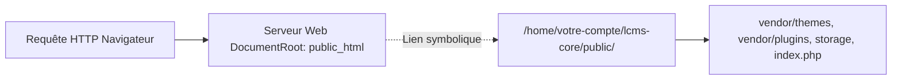
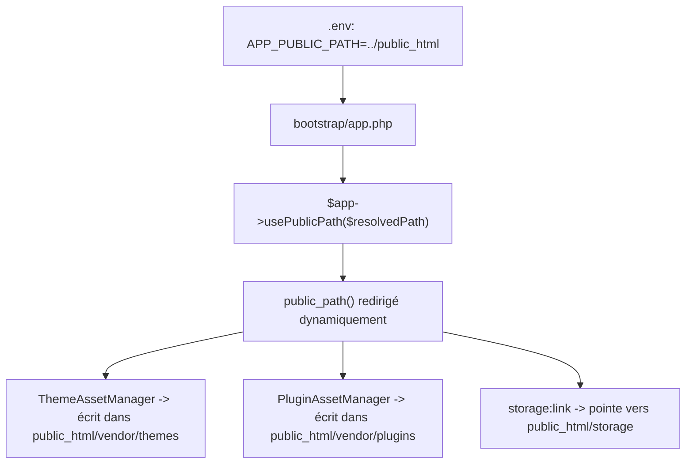

# Guide de Déploiement et Résolution : Hébergement Mutualisé & Dossier `public_html`

Ce document technique détaille la cause, les symptômes et les deux solutions d'ingénierie permettant de faire fonctionner **LCMS Core** (ou toute application Laravel 11/12) sur un hébergement mutualisé (cPanel, Plesk, DirectAdmin, etc.) où la racine Web publique est configurée dans un dossier distinct nommé `public_html` (ou `www`, `htdocs`).

---

## 1. Contexte & Diagnostic du Problème

### A. Arborescence typique sur hébergement mutualisé

Sur un serveur mutualisé classique, le répertoire racine de votre compte FTP/SSH n'est pas le projet Laravel, mais la racine du compte utilisateur :

```text
/home/votre-compte/
│
├── public_html/              <-- Racine Web (DocumentRoot Apache/LiteSpeed)
│   ├── index.php             <-- Point d'entrée HTTP
│   └── .htaccess
│
└── lcms-core/                <-- Code de l'application (isolé hors du web)
    ├── Core/
    ├── Plugins/
    ├── themes/
    ├── storage/
    ├── bootstrap/
    └── public/               <-- Dossier public par défaut généré par Laravel
```

### B. Les Symptômes observés

1. **Erreurs 404 sur les assets de thèmes et plugins :**
   Les feuilles de style, scripts et logos (`/vendor/themes/{theme-id}/...` ou `/vendor/plugins/{plugin-id}/...`) renvoient une erreur HTTP 404.
2. **Erreurs 404 sur les médias :**
   Les fichiers téléversés dans la médiathèque (`/storage/media/...`) sont introuvables.
3. **Échec des commandes de publication :**
   Lorsqu'une commande telle que `php artisan cms:theme:publish-assets --all` est exécutée, les fichiers sont copiés dans `lcms-core/public/vendor/` au lieu de `public_html/vendor/`. Les visiteurs du site Web ne voient donc jamais les fichiers mis à jour.

### C. Cause Racine Technique

Par défaut dans Laravel, la fonction d'aide `public_path()` est câblée en dur sur `base_path('public')`, soit :
`/home/votre-compte/lcms-core/public`

Or, le serveur Web Apache/LiteSpeed sert les requêtes HTTP depuis :
`/home/votre-compte/public_html`

Il y a donc une **dissociation totale** entre le dossier où Laravel publie ses assets et le dossier où le serveur Web cherche les fichiers demandés par les navigateurs.

---

## 2. Solution 1 : Résolution par Infrastructure (Lien Symbolique)

> [!TIP]
> **Recommandation prioritaire** : Cette approche est la plus propre et la plus standard si vous disposez d'un accès SSH ou d'un émulateur de Terminal dans votre interface cPanel.

### Principe de fonctionnement
Au lieu d'avoir un dossier physique `public_html`, on le remplace par un lien symbolique (*symlink*) Linux qui pointe directement vers le dossier `public` de votre projet `lcms-core`.



### Procédure pas-à-pas (Commandes Terminal SSH)

1. Connectez-vous en SSH ou ouvrez le **Terminal cPanel**.
2. Placez-vous à la racine de votre compte :
   ```bash
   cd /home/votre-compte
   ```
3. Déplacez ou sauvegardez le dossier `public_html` existant :
   ```bash
   mv public_html public_html_backup
   ```
4. Créez le lien symbolique vers le dossier `public` de LCMS Core :
   ```bash
   ln -s /home/votre-compte/lcms-core/public /home/votre-compte/public_html
   ```
5. Vérifiez que le lien est fonctionnel :
   ```bash
   ls -la public_html
   # Résultat attendu : public_html -> /home/votre-compte/lcms-core/public
   ```

### Avantages & Limites

| Avantages | Limites |
| :--- | :--- |
| **Zéro modification de code** dans le dépôt Git. | Nécessite un accès SSH ou le Terminal cPanel. |
| Parité absolue entre développement local et production. | Peut être restreint sur certains hébergements mutualisés très stricts (CageFS / open_basedir bloquant les symlinks). |
| Les commandes Artisan écrivent naturellement au bon endroit. | |

---

## 3. Solution 2 : Résolution Applicative Native (`.env` & `usePublicPath`)

> [!IMPORTANT]
> **Solution universelle** : Indispensable si votre hébergeur interdit les liens symboliques, n'offre pas d'accès SSH, ou impose un dossier physique `public_html`.

### Principe de fonctionnement
Laravel 11 et 12 fournissent la méthode interne `$app->usePublicPath($path)`. Elle redéfinit l'instance de liaison `path.public` dans le conteneur IoC.  
Ainsi, chaque appel système à `public_path()` (utilisé par `ThemeAssetManager`, `PluginAssetManager`, `storage:link` et les helpers `asset()`) ciblera directement `public_html`.



### Mise en œuvre technique

#### Étape 1 : Configuration du fichier `.env` en production
Ajoutez la variable d'environnement suivante dans le fichier `.env` sur le serveur :

```dotenv
# Chemin vers le dossier public web réel (relatif à la racine du projet ou absolu)
APP_PUBLIC_PATH=../public_html
# Ou en chemin absolu :
# APP_PUBLIC_PATH=/home/votre-compte/public_html
```

#### Étape 2 : Adaptation de `bootstrap/app.php`
Dans le fichier `bootstrap/app.php` de votre projet, juste après la configuration de `useAppPath`, insérez la logique de résolution dynamique :

```php
// Définition de l'AppPath pour LCMS Core
$app->useAppPath($app->basePath('Core'));

// Redirection dynamique du dossier public (Hébergement mutualisé public_html)
$configuredPublicPath = env('APP_PUBLIC_PATH');

if (! empty($configuredPublicPath)) {
    // Si un chemin spécifique est configuré dans le .env
    $resolvedPublicPath = str_starts_with($configuredPublicPath, '/') || preg_match('/^[a-zA-Z]:\\\\/', $configuredPublicPath)
        ? $configuredPublicPath
        : $app->basePath($configuredPublicPath);

    $app->usePublicPath($resolvedPublicPath);
} elseif (is_dir($app->basePath('../public_html'))) {
    // Détection automatique : si un dossier public_html existe au niveau supérieur
    $app->usePublicPath(dirname($app->basePath()).'/public_html');
}

return $app;
```

#### Étape 3 : Configuration du point d'entrée `public_html/index.php`
Assurez-vous que le fichier `public_html/index.php` charge correctement l'autoloader et l'application depuis le dossier frère :

```php
<?php

use Illuminate\Http\Request;

define('LARAVEL_START', microtime(true));

// 1. Charger l'autoloader Composer depuis le dossier lcms-core
require __DIR__.'/../lcms-core/vendor/autoload.php';

// 2. Démarrer l'application LCMS Core
$app = require_once __DIR__.'/../lcms-core/bootstrap/app.php';

// 3. Traiter la requête HTTP entrante
$request = Request::capture();
$response = $app->handleRequest($request);
$response->send();
```

### Avantages & Limites

| Avantages | Limites |
| :--- | :--- |
| **Fonctionne partout**, y compris sur les hébergements mutualisés les plus restreints. | Nécessite l'ajout de quelques lignes dans `bootstrap/app.php`. |
| **Bicéphale (Web & CLI)** : Fonctionne à la fois pour les requêtes HTTP et les commandes de console `php artisan`. | Il faut s'assurer que les permissions du dossier `public_html` permettent l'écriture par l'utilisateur PHP. |
| Transparent en local : si `APP_PUBLIC_PATH` n'est pas défini et qu'aucun `../public_html` n'existe, le dossier `public/` standard reste utilisé. | |

---

## 4. Matrice de Décision & Comparatif

| Critère d'évaluation | Solution 1 (Symlink Linux) | Solution 2 (Code `usePublicPath`) |
| :--- | :---: | :---: |
| **Modification du code Git** | Aucune (0 ligne) | Mineure (`bootstrap/app.php`) |
| **Accès SSH requis** | Oui | Non (fonctionne via simple FTP/Gestionnaire de fichiers) |
| **Compatibilité hébergeurs ultra-restreints** | Moyenne (dépend des restrictions symlink) | Maximale (100% compatible) |
| **Exécution Artisan CLI (`publish-assets`, etc.)** | Transparente | Native via `bootstrap/app.php` |
| **Complexité de maintenance** | Nulle après création | Nulle après configuration `.env` |

---

## 5. Checklist Post-Déploiement & Dépannage

Après avoir mis en place l'une des deux solutions, effectuez systématiquement les vérifications suivantes :

1. **Vérifier les permissions des dossiers :**
   ```bash
   chmod -R 775 storage bootstrap/cache
   chmod 755 public_html
   ```

2. **Créer le lien symbolique pour le stockage public :**
   ```bash
   php artisan storage:link
   ```
   *Vérifiez qu'un lien ou dossier `storage` existe bien à l'intérieur de `public_html`.*

3. **Publier tous les assets statiques des extensions et des thèmes :**
   ```bash
   php artisan cms:theme:publish-assets --all --force
   php artisan cms:plugin:publish-assets --all
   ```

4. **Vider et optimiser les caches Laravel :**
   ```bash
   php artisan optimize:clear
   php artisan config:cache
   php artisan route:cache
   php artisan view:cache
   ```

5. **Tester l'accès direct aux assets depuis le navigateur :**
   - Styles d'un thème : `https://votresite.com/vendor/themes/default-modern/css/theme.css`
   - Styles d'un plugin : `https://votresite.com/vendor/plugins/lcmscore.media-library/css/media.css` (selon les plugins installés)
   - Code HTTP attendu : `200 OK`.
